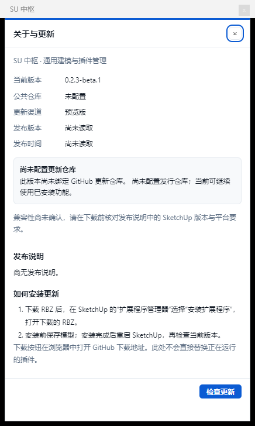

# TT中枢 · SketchUp 核心测试版

TT中枢（原 SU 中枢）提供命令面板、插件官方入口、运行诊断和 7 个内置建模工具。当前核心测试版面向 Windows / SketchUp 2024；尚未达到成熟商业工具的完整功能范围。实际维护仓库为 [tli96692-maker/TT-SU](https://github.com/tli96692-maker/TT-SU)，可安装版本以公开的 Release 附件为准；仅有源码提交不表示安装包已发布。

本仓库也包含可安装的 Codex skill：`skills/tt-su-hub`，用于安装指导、诊断、更新检查和公开源码维护。普通 SketchUp 用户安装 RBZ 即可；需要 Codex 辅助的用户可按 [skill 安装与分享说明](skill-sharing.md) 安装 `$tt-su-hub`。

下面是真实 SketchUp 中的更新界面。截图取自尚未绑定发行仓库的 Core 包；正式绑定后会显示实际仓库与检查结果。



## 安装与更新

从本仓库 **Releases** 下载 `su_zhongshu-core.rbz`，在 SketchUp 的“扩展程序管理器 → 安装扩展程序”选择它，然后重启 SketchUp。GitHub 自动生成的 Source code ZIP 是源码，不能直接安装。

对外产品名为 TT中枢，当前软件内菜单仍显示“SU 中枢”。安装重启后，从 **扩展程序 → SU 中枢 · 面板** 打开，面板底部可进入“关于与更新”。普通使用者只需 Windows 和 SketchUp 2024，不需要 GitHub Desktop、Python、Node.js 或 Ruby 开发环境。

核心包不需要 TT_Lib²，第三方工具需在各作者官方渠道另行安装。市场显示官网入口，不提供未核验的离线第三方包。升级前保存模型并备份原有设置与安装目录；沿用 `SUHub` / `su_zhongshu` 技术命名空间以兼容已有设置。已有额外插件不属于 Core 发行包，保留其独立备份和来源。

“关于与更新”会显示版本、发布渠道和仓库配置。面板连接宿主后会自动在后台检查一次，也支持手动检查；同一 SketchUp 进程缓存成功结果 10 分钟、失败结果 30 秒。找到兼容新版后显示提醒并提供 Release 入口，由用户下载、校验并安装；本版本不自动替换正在运行的插件，也不声称已经完成下载文件的本机校验。未绑定仓库时会明确提示，不能检查在线版本。

## 内置工具与限制

| 工具 | 当前支持范围 |
|---|---|
| 模型统计 | 当前层级/全模型统计、CSV/JSON 导出 |
| 圆角/倒角 | 符合条件的凸直边；不是任意复杂实体圆角 |
| 推拉 | 共面合并、正负向推拉、毫米输入 |
| 放样 | 两条无分叉轮廓之间生成曲面 |
| 地形 | 多层水平等高线之间生成三角带 |
| 喷漆 | 射线拾取正反面材质、隔离共享组件 |
| 缩放 | 按轴倍率/目标尺寸、局部轴及锚点 |

请先在模型副本中试用。浏览器与离线 Ruby 测试不等于所有真实几何场景已验证；不同 SketchUp 版本和 macOS 不在当前声明兼容范围内。

## 构建与检查

以下工具面向开发与发行维护者：Windows PowerShell 5.1+ 或 PowerShell 7、Ruby 3.2、Python 3.12、Node.js 22；首次上传可使用 GitHub Desktop。开发依赖由锁文件固定。签名后重新生成 manifest 和校验文件也需要本机 Python 3.12。

```powershell
npm ci --ignore-scripts
npx playwright install chromium
ruby --disable-gems tests/run_all.rb
python -m unittest discover -s tests -p test_prepare_next_release.py
npm run test:ui
powershell -NoProfile -ExecutionPolicy Bypass -File tools/build-rbz.ps1 -Core
python tools/verify-public-release.py
```

产物在 `dist/su_zhongshu-core.rbz`。公开源码不含私有工作区、模型、历史日志或第三方归档，克隆后可以独立构建 Core。公开发布时传 `-Repository tli96692-maker/TT-SU` 绑定更新来源，详见 [首次发布与后续更新](github-setup.md)（在仓库首页请打开 `docs/github-setup.md`）。

后续维护可用 [版本更新命令](maintenance-commands.md) 同步宿主、npm 锁文件和发布渠道。默认只预览，明确 `--apply` 才保存，保存前自动备份。

## 反馈与许可

通过仓库 Issues 报告问题，附插件版本、SketchUp 版本、复现步骤和错误信息；提交前移除私人路径及模型内容。自研部分采用 [MIT License](../LICENSE)，第三方信息见 [THIRD_PARTY_NOTICES.md](../THIRD_PARTY_NOTICES.md)；在仓库首页请直接打开根目录对应文件。
